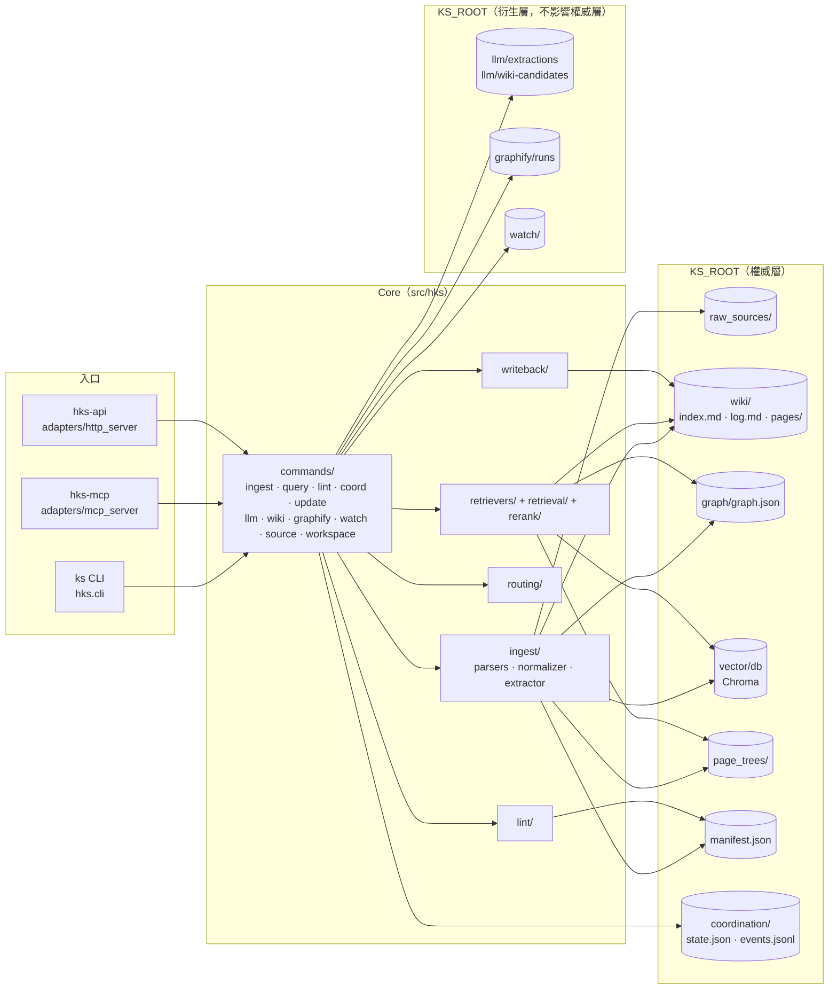
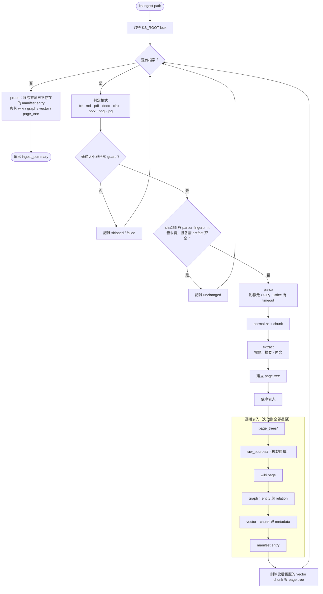
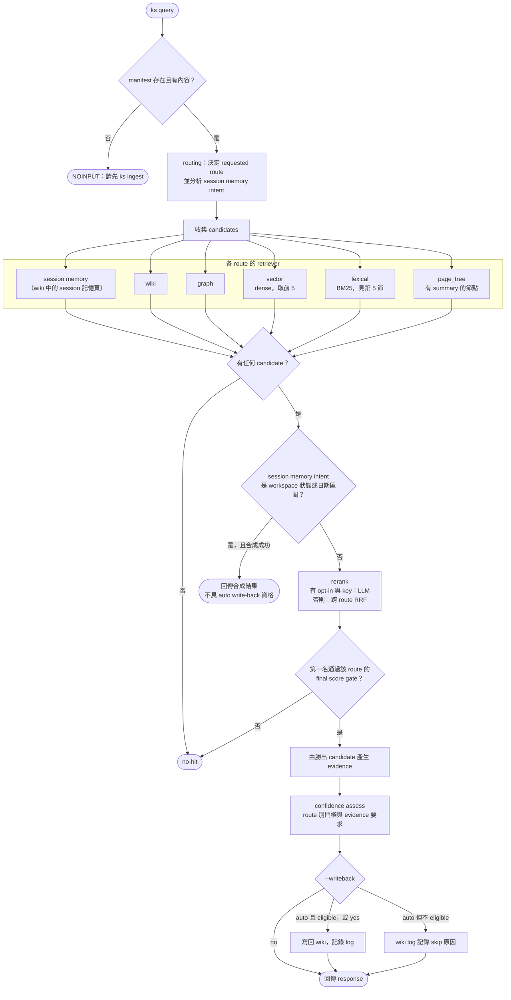
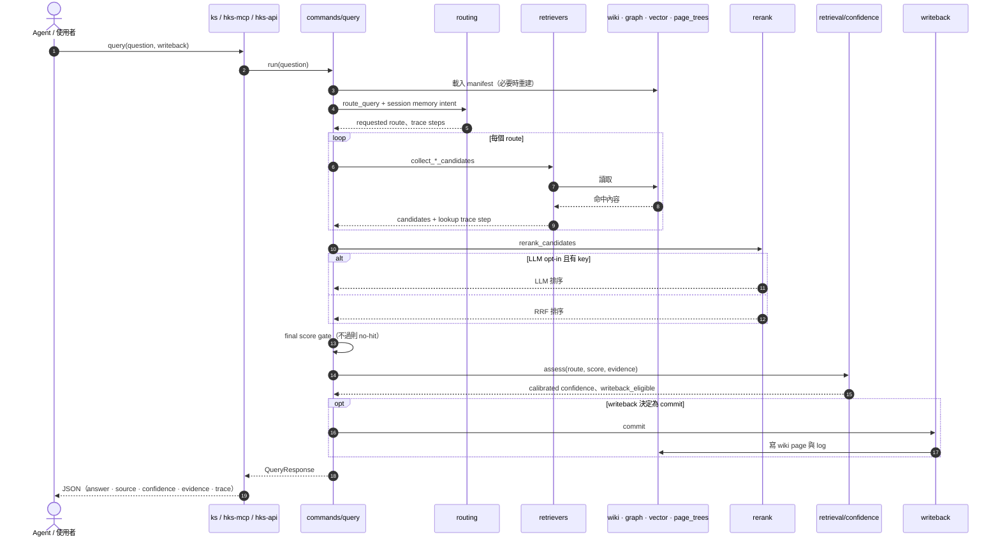
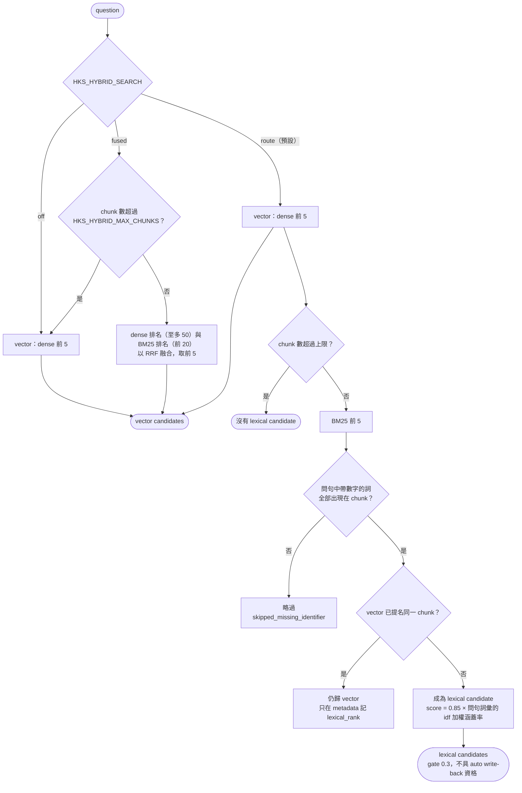
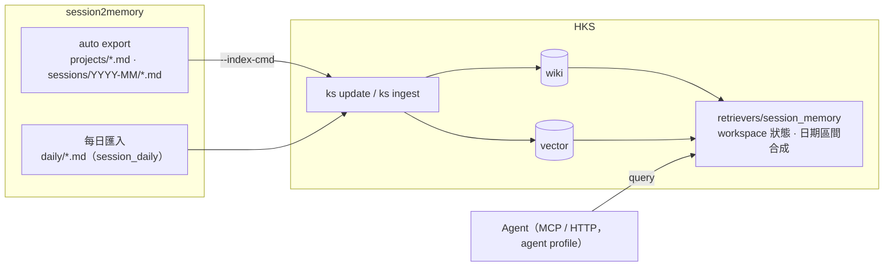

# 架構圖、流程圖與時序圖

本頁以 Mermaid 畫出 HKS 目前 runtime 的實際結構，依 `src/hks/` 的程式繪製。契約的文字敘述以 [main.md](main.md) 為準；兩者不一致時以 runtime code 與測試為事實，並請修正本頁。

`LLM wiki Graphify.png` 等圖是早期的概念願景（含 Neo4j、RBAC、雲端連接器等未實作項目），不代表現況。

## 1. 系統架構

三個入口共用同一組 command 與儲存層；沒有常駐服務，每次呼叫結束即退出（`hks-mcp` / `hks-api` 是本機 adapter）。

## 2. Ingest 流程

`ks ingest <path>`（`ingest/pipeline.py`）。寫入是逐檔的：任一步失敗會把該檔已寫入的各層還原，其他檔不受影響。

## 3. Query 流程

`ks query "<q>"`（`commands/query.py`）。不是 sequential fallback：各 route 都收集 candidates 後統一排序。

## 4. Query 時序圖

## 5. Keyword 檢索（`HKS_HYBRID_SEARCH`）

BM25 在 query 時對 vector store 的所有 chunk 即時計算，沒有落地索引。預設是 `route` 模式；細節與比較數字見 [specs/020](../specs/020-hybrid-lexical-retrieval/spec.md)。

## 6. 與 session2memory 的銜接

session2memory 把各 agent 的 session 整理成 Markdown；HKS 只讀它輸出的檔案，不直接讀任何 agent 的 session store。

